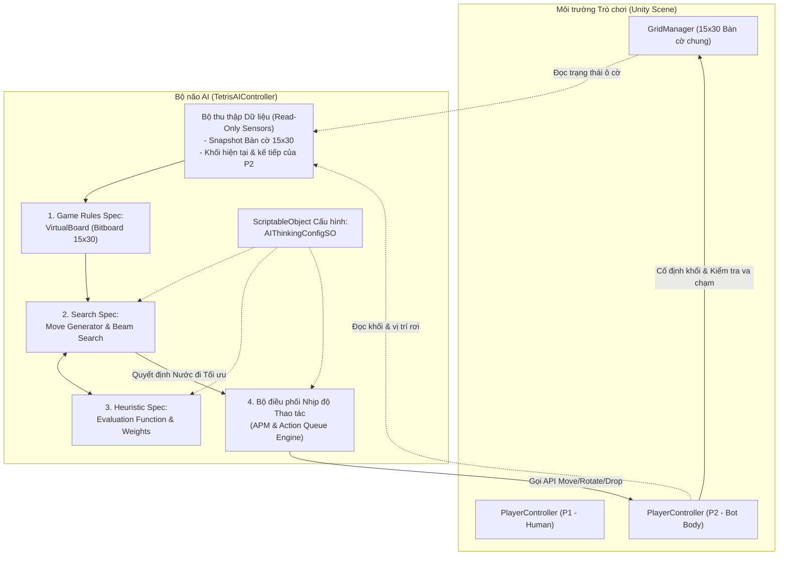

# TÀI LIỆU KỸ THUẬT: HỆ THỐNG TRÍ TUỆ NHÂN TẠO (AI) - TERRIS 2P

Tài liệu này mô tả chi tiết kiến trúc, nguyên lý hoạt động, công thức toán học và quy trình thực thi của hệ thống AI (Máy - P2) trong trò chơi **Terris 2P**.

---

## 1. TỔNG QUAN KIẾN TRÚC (ARCHITECTURE OVERVIEW)

Trong Terris 2P, AI được thiết kế theo mô hình **Tác tử độc lập (Autonomous Agent)** với nguyên tắc phân tách trách nhiệm nghiêm ngặt:
- **Người chơi (P1)**: Rơi từ trên xuống (-Y), mép chết là hàng 29.
- **Máy (P2)**: Rơi từ dưới lên (+Y), mép chết là hàng 0.
- **Ràng buộc kiến trúc cốt lõi**:
  - AI chỉ có quyền **đọc (Read-Only)** trạng thái bàn cờ `GridManager` và thông tin khối gạch của chính mình.
  - AI **tuyệt đối không can thiệp trực tiếp vào mảng ô cờ, không gọi hàm xóa hàng, không chỉnh sửa thuộc tính nội bộ của GridManager**.
  - Mọi hành vi đặt khối của AI đều được chuyển hóa thành các lệnh bấm phím thông qua API người chơi của `PlayerController`:
    - `Move(int deltaX)`: Sang trái (-1) hoặc sang phải (+1).
    - `RotatePiece()`: Xoay khối (hỗ trợ Wall-Kick).
    - `TriggerHardDrop()`: Thả khối tức thì xuống vị trí bóng mờ.
    - `SetSoftDrop(bool active)`: Bật/tắt tăng tốc độ rơi tự nhiên.

---

## 2. CÁC QUY CHUẨN THUẬT TOÁN (ALGORITHM SPECIFICATIONS)

### 2.1. Quy chuẩn 1: Game Rules Specification (Bàn cờ ảo Bitboard)
Để AI có thể tính toán hàng nghìn khả năng trong vòng $1 \sim 2$ mili-giây mà không tạo rác bộ nhớ (Zero Garbage Collection), cấu trúc `VirtualBoard` mô phỏng bàn cờ $15 \times 30$ bằng mảng số nguyên 16-bit:
- **Biểu diễn dữ liệu**:
  - `ushort[30] rows`: Mỗi hàng 15 ô được nén thành 15 bit (bit 0 đến 14).
  - `ushort[30] indestructible`: Đánh dấu các ô thuộc rào chắn cố định.
  - Mặt nạ hàng đầy (`FullRowMask`): `0x7FFF` ($2^{15} - 1 = 32767$).
- **Kiểm tra va chạm (`CanPlace`)**:
  - Với mỗi ô $(x, y)$ của khối sau khi xoay:
    $$\text{Valid} \iff 0 \le x < 15 \land 0 \le y < 30 \land (rows[y] \ \& \ (1 \ll x)) == 0$$
  - Hoàn toàn là các phép toán bitwise, thời gian xử lý $< 10$ nano-giây.
- **Trọng lực & Thả bóng mờ (`TryDropPiece`)**:
  - P2 rơi theo hướng $+Y$ (lên trên về phía rào chắn).
  - Khối được tịnh tiến từng bước $y + 1$ cho tới khi va chạm. Vị trí ngay trước va chạm là `GhostPivot`.
- **Cơ chế Đẩy dồn khi phá hàng (`CollapseTowardOpponent`)**:
  - Tái hiện chính xác 100% thuật toán của `GridManager`:
    - Khi P2 xóa một hàng: Toàn bộ các hàng phía trên hàng bị xóa (bao gồm cả 2 hàng rào chắn cố định) sẽ bị đẩy **LÊN** 1 hàng về phía P1.
    - Các hàng phía dưới hàng bị xóa dời lên 2 hàng lấp vào khoảng trống.
    - Bất kỳ khối nào bị đẩy vượt qua hàng 29 sẽ bị hủy hoàn toàn.
- **Quy tắc Mất tim & Tái cân bằng vòng chơi (`ExecuteHeartLossReset`)**:
  - Khi một bên chạm mép chết (P1 chạm hàng 29 hoặc P2 chạm hàng 0):
    - Bên bị trừ máu bị **xóa sạch toàn bộ 100% số khối**.
    - 2 hàng rào chắn cố định trở về chính giữa bàn cờ (hàng 14-15).
    - Bên không bị trừ máu **giữ nguyên vị trí các khối của mình** (không di chuyển tịnh tiến). Các khối bị xóa của bên này chỉ là những khối nằm trên đường di chuyển của Rào chắn trung tâm đến vị trí giữa (`sweepMinY` đến `sweepMaxY`).

---

### 2.2. Quy chuẩn 2: Heuristic Specification (Hàm Lượng giá Trạng thái)
Hàm lượng giá đánh giá giá trị chiến lược của trạng thái bàn cờ $S$ sau nước đi của P2:

$$\text{Eval}(S) = w_{\text{lines}} \cdot \text{LinesBonus} + w_{\text{danger}} \cdot \text{DangerScore} + w_{\text{holes}} \cdot \text{Holes} + w_{\text{bump}} \cdot \text{Bumpiness} + w_{\text{push}} \cdot \text{BarrierAdvantage} + w_{\text{p1}} \cdot \text{P1Vulnerability}$$

#### Diễn giải các thành phần:
1. **$\text{DangerScore}$ (Khoảng cách an toàn tới mép chết Row 0)**:
   - Với P2, mép chết là hàng 0. Gọi $minY$ là hàng thấp nhất có khối của P2:
     - Nếu $minY \le 1$: Phạt $-250 \times w_{\text{danger}}$ (Nguy cơ thua trận cận kề).
     - Nếu $minY \le 3$: Phạt $-50 \times (4 - minY) \times w_{\text{danger}}$.
     - Nếu $minY \ge 4$: Thưởng $+2 \times (minY - 3) \times w_{\text{danger}}$ (vùng an toàn sát rào chắn).
2. **$\text{LinesBonus}$ (Thưởng phá hàng & Đẩy dồn sân)**:
   - 1 hàng: $\times 1.0 \cdot w_{\text{lines}}$
   - 2 hàng: $\times 2.5 \cdot w_{\text{lines}}$
   - 3 hàng: $\times 5.0 \cdot w_{\text{lines}}$
   - 4 hàng (Tetris): $\times 10.0 \cdot w_{\text{lines}}$
3. **$\text{Holes}$ (Số lỗ hổng bị bẫy)**:
   - Với P2 (khối rơi từ $y=1$ lên), lỗ hổng là ô rỗng $(x, y)$ mà bên dưới nó ($y' < y$) đã có gạch bị khóa.
   - Phạt $-w_{\text{holes}} \times \text{HolesCount}$ (ngăn chặn tối đa việc xây gạch lủng lỗ).
4. **$\text{Bumpiness}$ (Độ gồ ghề của bề mặt đón gạch)**:
   - Bề mặt đón gạch của P2 quay về phía $y=0$.
   - Tính tổng độ chênh lệch hàng nhỏ nhất giữa các cột liền kề: $\sum_{x=0}^{13} |SurfaceY[x] - SurfaceY[x+1]|$.
5. **$\text{BarrierAdvantage}$ (Lợi thế kiểm soát rào chắn trung tâm)**:
   - Rào chắn bắt đầu ở hàng 14-15. Nếu rào chắn bị đẩy lùi lên $minY_{\text{barrier}} > 14$, P2 mở rộng vùng kiểm soát và thu hẹp sân P1.
   - Thưởng $+5 \times (minY_{\text{barrier}} - 14) \times w_{\text{push}}$.
6. **$\text{P1Vulnerability}$ (Khai thác sơ hở của P1)**:
   - Nếu P1 có khối xếp cao sát hàng 29 ($maxY_{\text{P1}} \ge 26$), một đòn phá hàng của P2 có thể hạ gục P1 ngay lập tức.
   - Thưởng $+5 \times (maxY_{\text{P1}} - 25) \times w_{\text{p1}}$.

---

### 2.3. Quy chuẩn 3: Search Specification (Sinh Nước đi & Beam Search)

#### 1. Sinh không gian nước đi (Move Generation):
- Tối ưu góc xoay đối xứng:
  - Khối O: 1 góc xoay ($r=0$).
  - Khối I, S, Z: 2 góc xoay ($r \in \{0, 1\}$).
  - Khối T, J, L: 4 góc xoay ($r \in \{0, 1, 2, 3\}$).
- Với mỗi góc xoay, quét mọi tọa độ $x \in [minX, maxX]$ vừa vặn trong chiều rộng 15 ô.
- Thả rơi lên trên bằng `TryDropPiece` để tìm vị trí tiếp đất.
- Sinh ra trung bình $25 \sim 35$ nước đi hợp lệ cho mỗi lượt.

#### 2. Tìm kiếm chùm đa tầng (Beam Search):
- **Tầng 1 (Current Piece)**: Lượng giá toàn bộ nước đi của khối hiện tại.
- **Cắt tỉa Beam Width ($K$)**: Sắp xếp và chỉ giữ lại $K$ ứng viên có điểm Heuristic cao nhất.
- **Tầng 2 (Next Piece Lookahead)**: Với mỗi ứng viên trong $K$, sinh toàn bộ nước đi của khối tiếp theo (`nextType`) trên bàn cờ dự kiến.
- Điểm tổng hợp: $Score_{\text{total}} = Score_{\text{Level 1}} + \text{lookaheadDiscount} \times Score_{\text{Level 2}}$.
- Nước đi tốt nhất ở Tầng 1 sẽ là quyết định được lựa chọn.

---

## 3. BẢNG THÔNG SỐ CÁC CẤP ĐỘ KHÓ (DIFFICULTY TUNING MATRIX)

Hệ thống đã được cân chỉnh lại tốc độ phản xạ và nâng cấp trí thông minh cho cấp độ Dễ:

| Tiêu chí | Dễ (Easy) - Đã nâng cấp | Vừa (Medium) | Khó (Hard) | Tối thượng (Master) |
|---|---|---|---|---|
| **Độ sâu tìm kiếm (Depth)** | 2 (Xét cả khối tiếp theo) | 2 (Full 2 tầng) | 2 (Full 2 tầng) | 2 (Full 2 tầng) |
| **Độ rộng chùm (Beam Width)** | 4 (Tìm nước đi gọn gàng) | 8 | 14 | 24 |
| **Nhiễu ngẫu nhiên Heuristic** | $\pm 6$ (Sai số nhẹ tự nhiên) | 0 (Không lỗi) | 0 (Chuẩn xác) | 0 (Tối ưu tuyệt đối) |
| **Thời gian suy nghĩ (Think Delay)** | $0.12$ giây (Nhanh, trước là 0.35s) | $0.05$ giây (Rất nhanh) | $0.015$ giây (Chớp mắt) | $0.00$ giây (Tức thì) |
| **Khoảng cách thao tác (Pacing)** | $0.09$ giây (~330 APM) | $0.055$ giây (~550 APM) | $0.035$ giây (~850 APM) | $0.015$ giây (~1300+ APM) |
| **Phương thức thả khối** | Thả tức thì (Hard Drop) | Thả tức thì (Hard Drop) | Thả tức thì siêu tốc | Thả tức thì chớp nhoáng |
| **Trí thông minh xếp gạch** | Xếp gọn, tránh lỗ, dọn hàng | Tấn công tốt, bề mặt phẳng | Xây combo, dồn ép đối thủ | Tối ưu hóa điểm số tuyệt đối |

---

## 4. QUY TRÌNH THỰC THI THAO TÁC (ACTION PACING & ANTI-STUCK)

Bộ điều phối `TetrisAIController` hoạt động trong vòng lặp `Update()`:
1. **Lập kế hoạch (Planning)**: Khi P2 sinh khối mới, AI kích hoạt `TetrisAISearch.FindBestMove()` tạo ra kế hoạch gồm `targetX`, `targetRotation` và `shouldHardDrop`.
2. **Tuần tự thao tác**:
   - Nếu `Rotation != targetRotation`: Gọi `playerController.RotatePiece()`.
   - Nếu `Pivot.x < targetX`: Gọi `playerController.Move(1)`.
   - Nếu `Pivot.x > targetX`: Gọi `playerController.Move(-1)`.
   - Khi đã khớp cả $X$ và $Rotation$:
     - Nếu `shouldHardDrop == true`: Gọi `playerController.TriggerHardDrop()`.
     - Nếu `shouldHardDrop == false`: Gọi `playerController.SetSoftDrop(true)`.
3. **Cơ chế Chống kẹt (Anti-Stuck)**:
   - Nếu khối bị kẹt tại một tọa độ quá số chu kỳ cho phép (`maxStuckCount`), AI tự động kích hoạt `TriggerHardDrop()` để giải phóng lượt và chuyển sang khối kế tiếp.

---

## 5. SCRIPTABLEOBJECT CẤU HÌNH SUY NGHĨ (AIThinkingConfigSO)

Hệ thống cung cấp ScriptableObject [`AIThinkingConfigSO`](file:///f:/Leaning/Project/Terris2P/Assets/Terris2P/Scripts/AI/AIThinkingConfigSO.cs) cho phép Game Designer tùy biến toàn bộ thông số tư duy của AI trực tiếp trong Unity Inspector mà không cần sửa code:

- **Menu tạo Asset**: Chuột phải trong cửa sổ Project $\rightarrow$ `Create` $\rightarrow$ `Terris2P` $\rightarrow$ `AI Thinking Config`.
- **Đường dẫn Asset mặc định**:
  - `Assets/Terris2P/Resources/AIThinkingConfig.asset` (Tự động tải khi không gán trong Inspector).
  - `Assets/Terris2P/Configs/DefaultAIThinkingConfig.asset` (Bản mẫu cấu hình).
- **Các thông số có thể tinh chỉnh trên Inspector**:
  - **Search**: `searchDepth` (1..2), `beamWidth` (1..32), `useLookahead` (bool), `lookaheadDiscount` (0..1).
  - **Heuristics**: `weightLineClear`, `weightDangerRow0`, `weightHoles`, `weightBumpiness`, `weightBarrierPush`, `weightP1Vulnerability`, `randomNoiseRange`.
  - **Pacing / APM**: `thinkingDelay`, `actionInterval`, `allowHardDrop`, `maxStuckCount`.
